# Dossier de conception — PharmaGest

Ce document décrit la conception retenue pour **PharmaGest**, application web de
gestion de pharmacie développée avec Django 5.2. Il complète le
[`README.md`](../README.md), le
[`guide d'utilisation`](GUIDE_UTILISATION.md) et les
[`spécifications internes`](SPEC_INTERNE.md).

Il présente successivement :

1. l'architecture logicielle ;
2. les acteurs et les cas d'utilisation (UML) ;
3. le modèle conceptuel de données (MCD) ;
4. le modèle logique de données (MLD) ;
5. le mappage des règles de gestion RG01 à RG12 ;
6. les diagrammes de séquence et les cycles de vie (UML) ;
7. les choix de sécurité, de transaction et de tests.

> Les schémas Mermaid sont rendus nativement par GitHub, GitLab et la plupart
> des éditeurs Markdown. Les identifiants des entités sont en ASCII afin de
> garantir leur compatibilité.

---

## 1. Architecture logicielle

PharmaGest suit le motif **MVT** (Model – View – Template) de Django, complété
par une couche de **services métier** pour les opérations qui doivent être
atomiques et traçables.

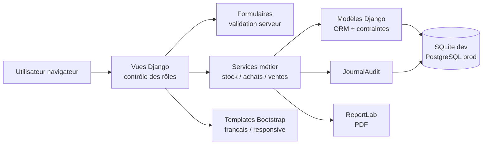

> Export image : [Architecture logicielle](diagrammes/01-architecture.png)

### 1.1 Applications Django

| Application | Responsabilité |
| --- | --- |
| `config` | Réglages, routage racine, WSGI/ASGI |
| `core` | Paramètres pharmacie, audit, utilitaires, sauvegardes, données démo, pages d'erreur |
| `utilisateurs` | `Utilisateur`, `Role`, authentification, permissions, signaux |
| `medicaments` | `Categorie`, `Medicament`, photo, catalogue |
| `fournisseurs` | `Fournisseur`, historique d'achats |
| `clients` | `Client`, historique de ventes |
| `stock` | `LotStock`, `MouvementStock`, `Inventaire`, `LigneInventaire`, alertes |
| `achats` | `CommandeAchat`, `LigneAchat`, `ReceptionAchat`, `LigneReception` |
| `ventes` | `Vente`, `LigneVente`, `Paiement`, `RetourVente`, `LigneRetour`, caisse |
| `rapports` | Tableaux de bord, rapports, génération PDF |

### 1.2 Couche services

Les règles critiques ne sont **pas** implémentées dans les vues. Elles sont
centralisées dans :

- `stock/services.py` : `appliquer_mouvement`, `receptionner_lot`,
  `creer_inventaire`, `valider_inventaire` ;
- `achats/services.py` : `valider_commande`, `annuler_commande`,
  `receptionner_commande` ;
- `ventes/services.py` : `lots_fefo`, `creer_vente`, `creer_retour`,
  `annuler_vente`, `confirmer_paiement`.

Chaque service utilise `transaction.atomic()` et, pour le stock,
`select_for_update()` afin de sérialiser les accès concurrents à un lot.

---

## 2. Acteurs et cas d'utilisation (UML)

Les rôles sont **cumulables**. Un superutilisateur ou un compte doté du rôle
`ADMIN` disposent de tous les droits.

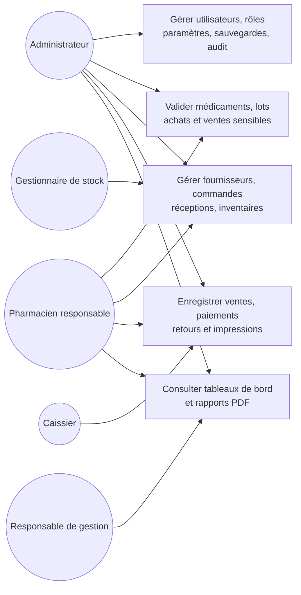

> Export image : [Acteurs et cas d'utilisation](diagrammes/02-cas-utilisation.png)

### 2.1 Matrice des autorisations

| Fonction | Rôles autorisés |
| --- | --- |
| Lecture du catalogue | tous les utilisateurs connectés |
| Création/modification/archivage des médicaments et catégories | `ADMIN`, `PHARMACIEN` |
| Fournisseurs, commandes, réceptions, stock, inventaires | `ADMIN`, `PHARMACIEN`, `GESTION_STOCK` |
| Clients, caisse, ventes, paiements, retours | `ADMIN`, `PHARMACIEN`, `CAISSIER` |
| Rapports détaillés et PDF | `ADMIN`, `PHARMACIEN`, `RESPONSABLE_GESTION` |
| Utilisateurs, paramètres, sauvegardes, journal d'audit | `ADMIN` |

Le contrôle est appliqué dans `RoleRequisMixin` / `AdminRequisMixin`, donc
**côté serveur**. Le masquage des boutons dans les templates n'est qu'un
confort d'interface.

---

## 3. Modèle conceptuel de données (MCD)

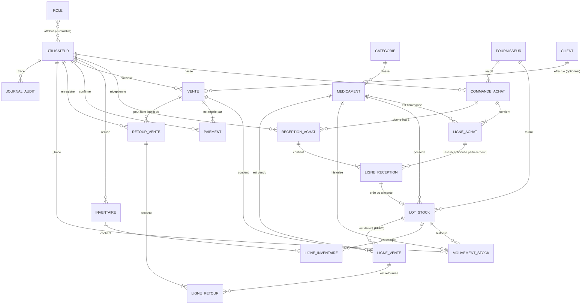

> Export image : [MCD — relations entre entités](diagrammes/03-mcd-relations.png)

### 3.1 Entités principales et attributs

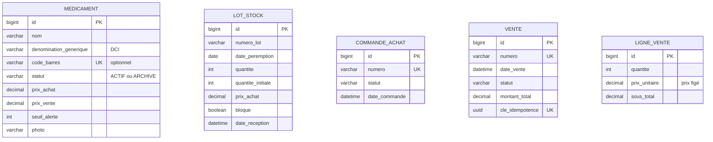

> Export image : [MCD — entités et attributs](diagrammes/04-mcd-entites-attributs.png)

---

## 4. Modèle logique de données (MLD)

Les conventions suivantes sont utilisées :

- `PK` : clé primaire ; `FK` : clé étrangère ; `UK` : contrainte d'unicité ;
- `NN` : non nul ; `Défaut` : valeur par défaut ;
- les montants utilisent `DecimalField` (jamais de flottant) ;
- les suppressions sont `PROTECT` ou `SET_NULL` pour préserver l'historique.

### 4.1 `utilisateurs_role` et `utilisateurs_utilisateur`

| Champ | Type | Contraintes |
| --- | --- | --- |
| `role.id` | bigint | PK |
| `role.code` | varchar(30) | UK, NN |
| `role.nom` | varchar(100) | NN |
| `role.description` | text | |
| `role.ordre` | smallint | NN |
| `utilisateur.id` | bigint | PK |
| `utilisateur.username` | varchar(150) | UK, NN |
| `utilisateur.email` | varchar(254) | |
| `utilisateur.roles` | M2M | vers `utilisateurs_role` |
| `utilisateur.is_active` | boolean | NN, Défaut `true` |

### 4.2 `medicaments_categorie` et `medicaments_medicament`

| Champ | Type | Contraintes |
| --- | --- | --- |
| `categorie.id` | bigint | PK |
| `categorie.nom` | varchar(120) | UK (insensible à la casse, validé par formulaire) |
| `medicament.id` | bigint | PK |
| `medicament.nom` | varchar(150) | NN |
| `medicament.denomination_generique` | varchar(150) | DCI |
| `medicament.categorie_id` | bigint | FK `PROTECT` |
| `medicament.code_barres` | varchar(80) | UK partiel (quand renseigné) |
| `medicament.photo` | varchar(100) | `ImageField`, max 3 Mo |
| `medicament.prix_achat`, `prix_vente` | decimal(12,2) | NN, > 0 |
| `medicament.seuil_alerte` | integer | NN, ≥ 0 |
| `medicament.statut` | varchar(10) | `ACTIF` / `ARCHIVE` |

### 4.3 `fournisseurs_fournisseur` et `clients_client`

| Champ | Type | Contraintes |
| --- | --- | --- |
| `fournisseur.id` | bigint | PK |
| `fournisseur.nom` | varchar(180) | NN |
| `fournisseur.numero_fiscal` | varchar(80) | |
| `fournisseur.actif` | boolean | NN, Défaut `true` |
| `client.id` | bigint | PK |
| `client.nom` | varchar(150) | NN |
| `client.telephone` | varchar(40) | |
| `client.actif` | boolean | NN, Défaut `true` |

### 4.4 `stock_lotstock`, `stock_mouvementstock`, `stock_inventaire`

| Champ | Type | Contraintes |
| --- | --- | --- |
| `lot.id` | bigint | PK |
| `lot.medicament_id` | bigint | FK `PROTECT` |
| `lot.numero_lot` | varchar(80) | NN |
| `lot.date_peremption` | date | NN |
| `lot.quantite` | integer | NN, ≥ 0 |
| `lot.quantite_initiale` | integer | NN, ≥ 0 |
| `lot.prix_achat` | decimal(12,2) | NN |
| `lot.fournisseur_id` | bigint | FK `SET_NULL` |
| `lot.bloque` | boolean | NN, Défaut `false` |
| `mouvement.id` | bigint | PK |
| `mouvement.lot_id` | bigint | FK `PROTECT` |
| `mouvement.type_mouvement` | varchar(25) | `ENTREE`, `SORTIE`, `RETOUR`, `CORRECTION`, `PERTE` |
| `mouvement.quantite` | integer | signé : `+` entrée, `-` sortie |
| `mouvement.utilisateur_id` | bigint | FK `PROTECT` |
| `inventaire.id` | bigint | PK |
| `inventaire.numero` | varchar(40) | UK |
| `inventaire.statut` | varchar(10) | `EN_COURS` / `VALIDE` |

`LigneInventaire` associe un lot à un inventaire avec `quantite_theorique` et
`quantite_comptee`.

### 4.5 `achats_*`

| Table | Champs clés | Contraintes |
| --- | --- | --- |
| `achats_commandeachat` | `numero` UK, `fournisseur_id` FK, `utilisateur_id` FK, `statut`, `date_commande` | statuts : `BROUILLON`, `COMMANDEE`, `PARTIELLEMENT_RECEPTIONNEE`, `RECEPTIONNEE`, `ANNULEE` |
| `achats_ligneachat` | `commande_id` FK, `medicament_id` FK, `quantite_commandee`, `quantite_recue`, `prix_achat_unitaire` | `quantite_recue ≤ quantite_commandee` |
| `achats_receptionachat` | `numero` UK, `commande_id` FK, `date_reception`, `utilisateur_id` FK | une réception est unique et immutable après validation |
| `achats_lignereception` | `reception_id` FK, `ligne_achat_id` FK, `lot_id` FK, `numero_lot`, `date_peremption`, `prix_unitaire`, `quantite` | lot et péremption obligatoires |

### 4.6 `ventes_*`

| Table | Champs clés | Contraintes |
| --- | --- | --- |
| `ventes_vente` | `numero` UK, `client_id` FK `SET_NULL`, `utilisateur_id` FK, `statut`, `montant_total`, `cle_idempotence` UK | `VALIDEE` / `ANNULEE` |
| `ventes_lignevente` | `vente_id` FK, `medicament_id` FK, `lot_id` FK, `quantite`, `prix_unitaire`, `sous_total` | prix figé, jamais recalculé |
| `ventes_paiement` | `vente_id` FK, `montant`, `mode`, `statut`, `reference`, `montant_recu`, `confirme_par_id` FK | modes électroniques : référence et confirmation obligatoires |
| `ventes_retourvente` | `numero` UK, `vente_id` FK, `type_retour`, `motif`, `montant_rembourse`, `mode_remboursement` | `RETOUR` ou `ANNULATION` |
| `ventes_ligneretour` | `retour_id` FK, `ligne_vente_id` FK, `quantite`, `prix_unitaire`, `remise_en_stock` | quantité ≤ quantité vendue restante |

### 4.7 `core_parametrepharmacie` et `core_journalaudit`

`ParametrePharmacie` est un singleton (`get_solo()`) utilisé par les documents
PDF : nom, adresse, téléphone, email, NIF, devise (`Ar` par défaut), seuil de
péremption, mentions légales, logo.

`JournalAudit` conserve `utilisateur_id`, `action`, `module`, `objet_id`,
`description`, `details`, `adresse_ip` et `date`.

---

## 5. Règles de gestion : conception → réalisation

| Règle | Traduction dans la conception |
| --- | --- |
| **RG01** Identifiant unique du médicament | `BigAutoField` + `code_barres` unique partiel validé côté serveur (`FormulaireMedicament.clean_code_barres`). |
| **RG02** Code-barres non dupliqué | Contrainte d'unicité en base et contrôle de formulaire insensible à la casse. |
| **RG03** Validation serveur des prix/quantités | `forms.py` + `clean()` des modèles + services ; aucun calcul de confiance côté navigateur. |
| **RG04** Commande ≠ stock | `valider_commande()` ne touche que le statut ; aucun `MouvementStock` n'est créé. |
| **RG05** Réception une seule fois | `receptionner_commande()` vérifie `peut_etre_receptionnee`, `select_for_update`, transaction atomique ; quantités reçues cumulées et plafonnées. |
| **RG06** Vente une seule fois | `cle_idempotence` unique ; `creer_vente()` atomique avec verrou sur les lots ; un double clic ne crée qu'une vente. |
| **RG07** Pas de stock négatif | `lots_fefo()` ne retient que les lots délivrables ; contrôle `quantite ≥ demandée` avant décrément. |
| **RG08** Lots périmés/bloqués exclus | `LotStock.est_delivrable` vérifie `bloque`, `date_peremption` et quantité ; filtre appliqué dans la caisse et le service. |
| **RG09** Traçabilité | `utilisateur`, `date`, `reference` sur les mouvements ; `journaliser()` sur les actions sensibles ; `JournalAudit`. |
| **RG10** Pas de suppression silencieuse | `PROTECT` sur les FK historiques ; retour/annulation compensatoires ; archivage des médicaments. |
| **RG11** Permissions | `RoleRequisMixin` sur chaque vue ; redirection vers la connexion ou `PermissionDenied` (403). |
| **RG12** Prix historiques figés | `LigneVente.prix_unitaire` et `sous_total`, `LigneAchat.prix_achat_unitaire`, `LigneReception.prix_unitaire` copiés au moment de l'opération. |

---

## 6. Dynamique du système (UML)

### 6.1 Séquence : vente FEFO et idempotence

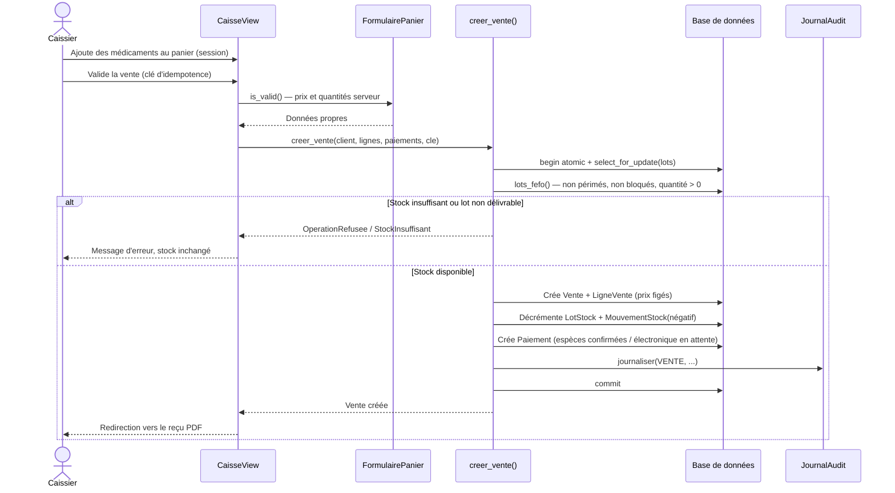

> Export image : [Séquence — vente FEFO et idempotence](diagrammes/05-sequence-vente-fefo.png)

### 6.2 Séquence : réception d'une commande

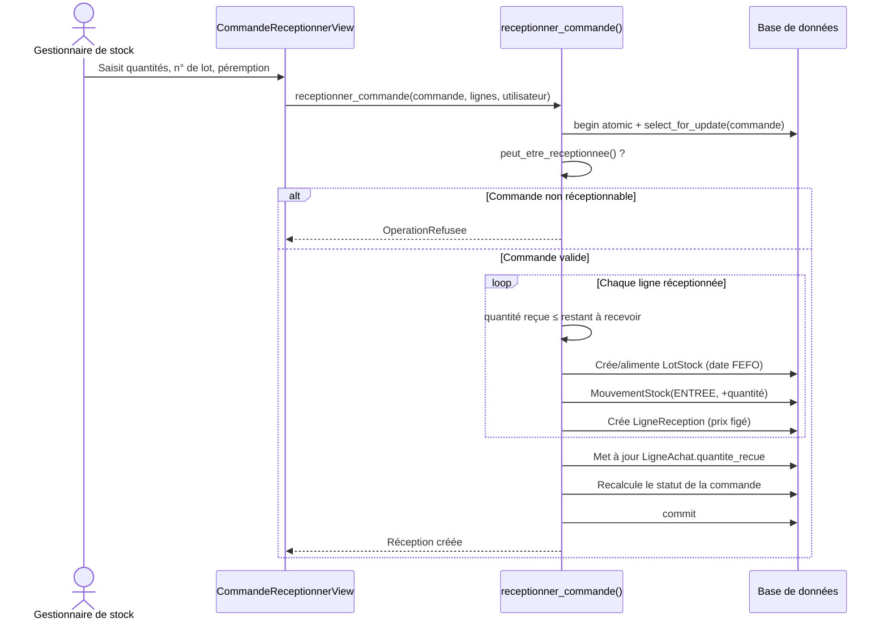

> Export image : [Séquence — réception d'une commande](diagrammes/06-sequence-reception.png)

### 6.3 Cycle de vie des objets métier

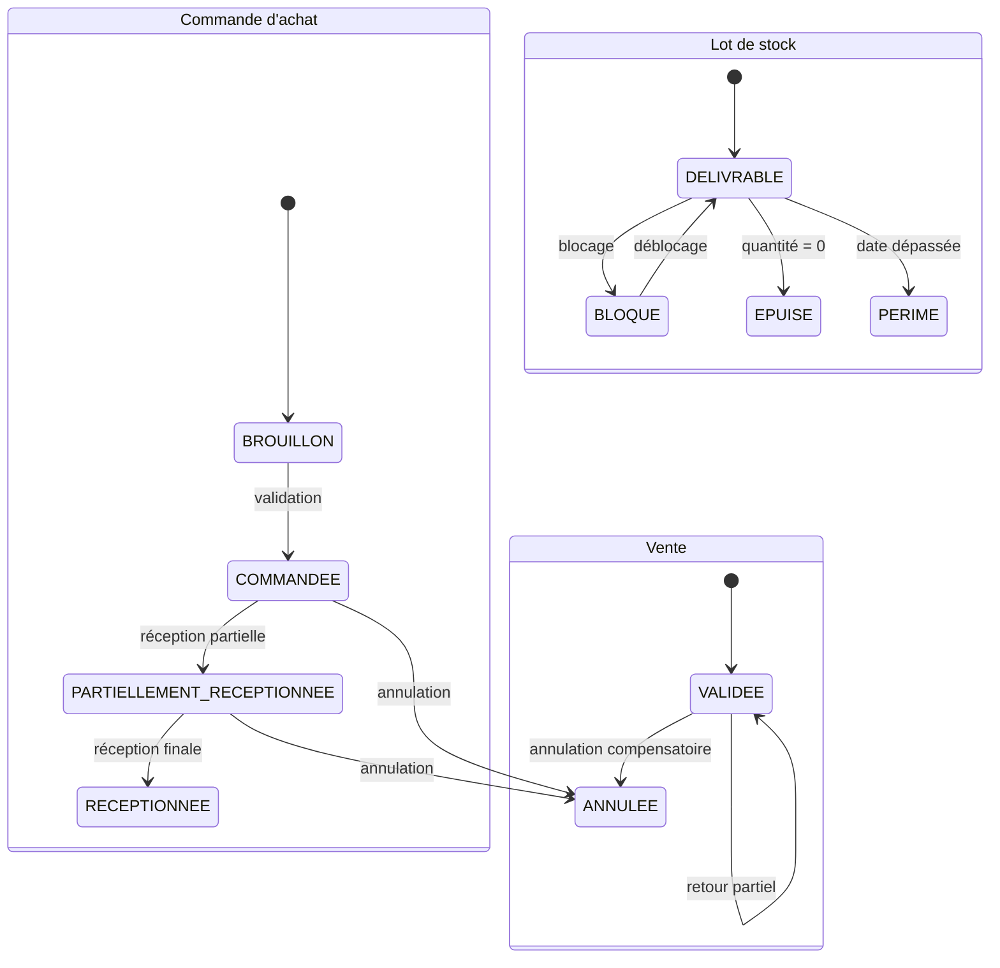

> Export image : [Cycle de vie des objets métier](diagrammes/07-cycle-de-vie.png)

### 6.4 Séquence : retour et annulation

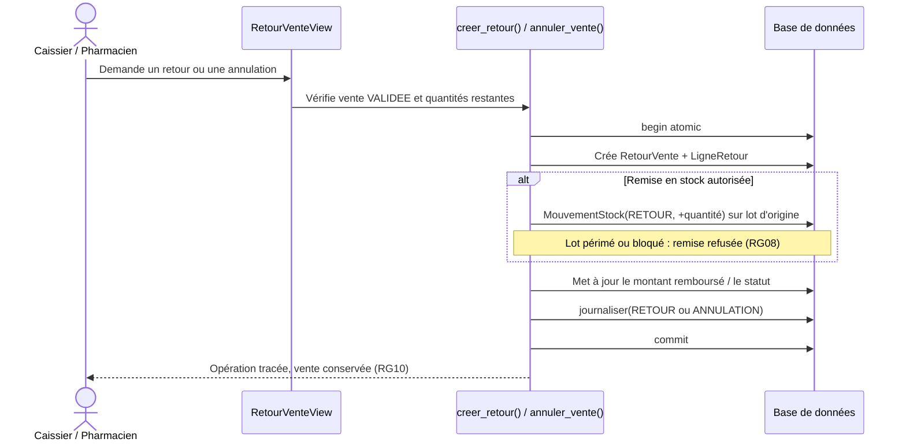

> Export image : [Séquence — retour et annulation](diagrammes/08-sequence-retour-annulation.png)

---

## 7. Sécurité, transactions et qualité

### 7.1 Sécurité

- Authentification via `utilisateurs.Utilisateur` (`AUTH_USER_MODEL`) ;
- roles M2M cumulables, contrôlés par `RoleRequisMixin` ;
- CSRF activé sur tous les formulaires POST ;
- mots de passe hachés par Django, validateurs de complexité ;
- journalisation des connexions et des actions sensibles ;
- téléversement d'images limité à 3 Mo et validé côté serveur (Pillow) ;
- configuration de production : HTTPS, cookies sécurisés, HSTS via variables
  d'environnement.

### 7.2 Transactions et concurrence

- `transaction.atomic()` pour les services de stock, achats et ventes ;
- `select_for_update()` sur les lots et les commandes concernés ;
- `cle_idempotence` unique pour les ventes ;
- vérification des états avant mutation (`peut_etre_receptionnee`,
  `est_delivrable`, `statut == VALIDEE`).

### 7.3 Tests

La suite de tests couvre :

- les modèles et contraintes (unicité, calculs, statuts) ;
- les services FEFO, réception, retour, annulation, inventaire ;
- les permissions par rôle et les codes HTTP ;
- les filtres, tris et paginations ;
- les documents PDF (en-tête `%PDF`) ;
- un **test de fumée complet** (`core/test_smoke.py`) qui charge
  `donnees_demo` et rend toutes les pages HTML et tous les PDF.

```bash
.venv/bin/python manage.py check
.venv/bin/python manage.py test
```

---

## 8. Glossaire

| Terme | Définition |
| --- | --- |
| **FEFO** | *First Expired, First Out* : le lot dont la péremption est la plus proche est délivré en premier. |
| **DCI** | Dénomination commune internationale du médicament. |
| **Lot** | Unité de stock homogène identifiée par un numéro et une date de péremption. |
| **Réception** | Opération qui transforme une commande en stock réel. |
| **Idempotence** | Propriété qui garantit qu'une même opération ne s'applique qu'une fois. |
| **Compensation** | Opération inverse tracée (retour/annulation) au lieu d'une suppression. |
| **Audit** | Enregistrement inaltérable de l'auteur, de la date et du détail d'une action. |

---

## 9. Galerie des diagrammes exportés

Les huit diagrammes ci-dessus sont également fournis en PNG dans
`docs/diagrammes/`. Cliquer sur une vignette pour ouvrir l'image en
taille réelle.

<div align="center">

**Architecture logicielle**

<a href="diagrammes/01-architecture.png">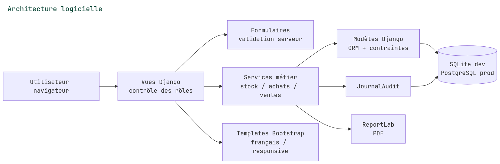</a>

**Acteurs et cas d'utilisation**

<a href="diagrammes/02-cas-utilisation.png">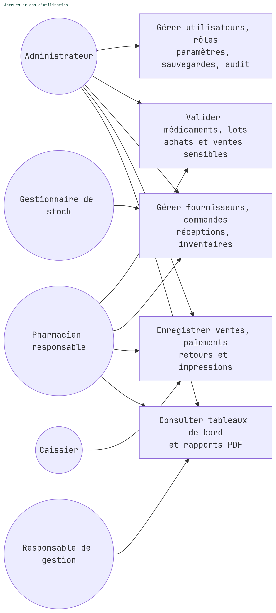</a>

**MCD — relations entre entités**

<a href="diagrammes/03-mcd-relations.png">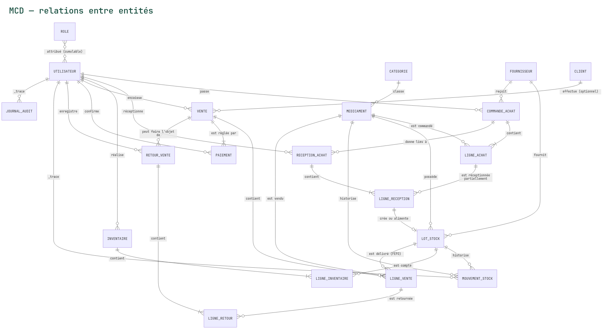</a>

**MCD — entités et attributs**

<a href="diagrammes/04-mcd-entites-attributs.png">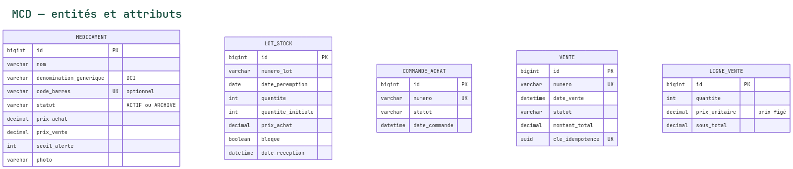</a>

**Séquence — vente FEFO et idempotence**

<a href="diagrammes/05-sequence-vente-fefo.png">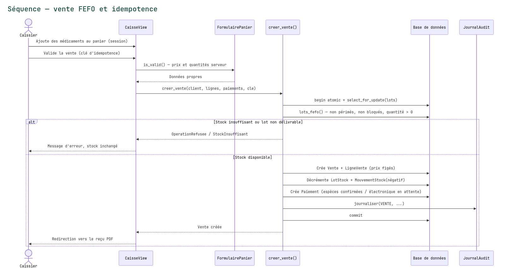</a>

**Séquence — réception d'une commande**

<a href="diagrammes/06-sequence-reception.png">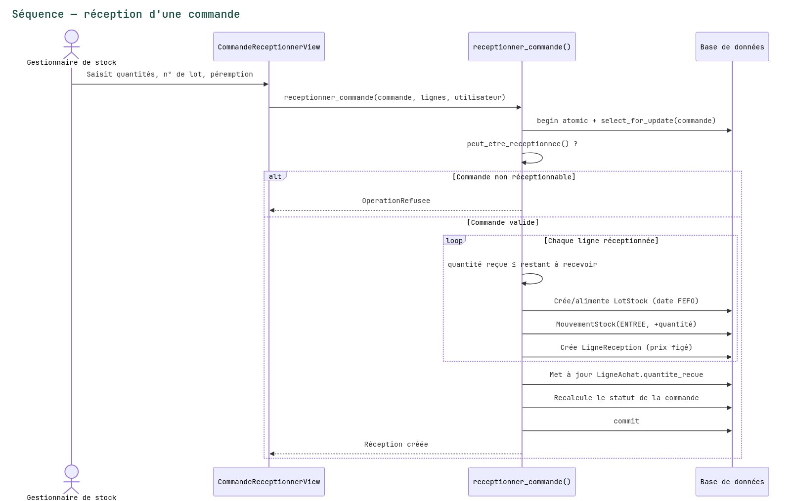</a>

**Cycle de vie des objets métier**

<a href="diagrammes/07-cycle-de-vie.png">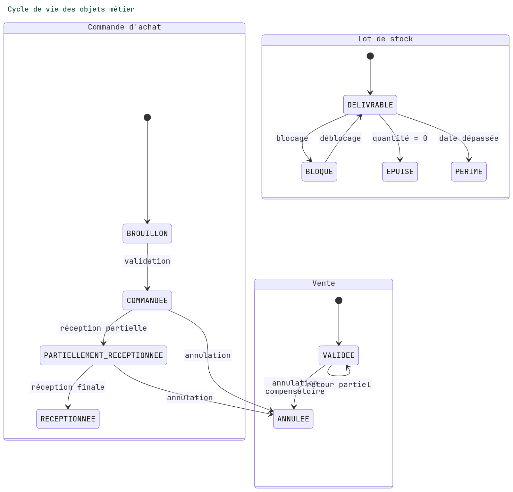</a>

**Séquence — retour et annulation**

<a href="diagrammes/08-sequence-retour-annulation.png">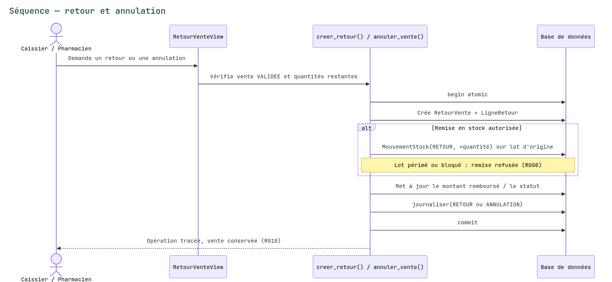</a>

</div>
